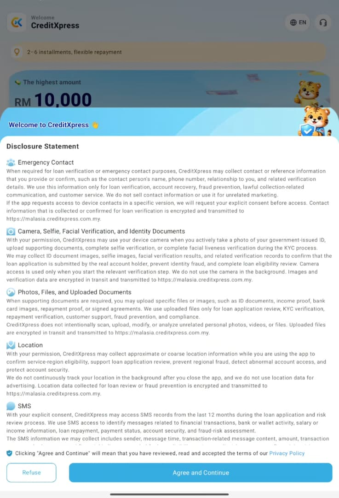
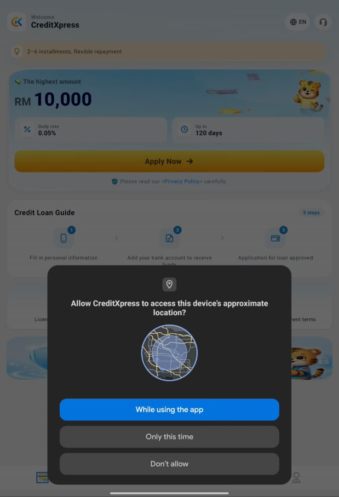
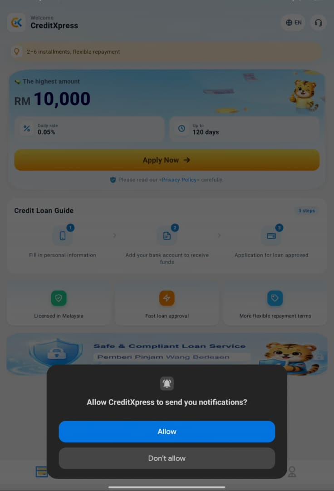
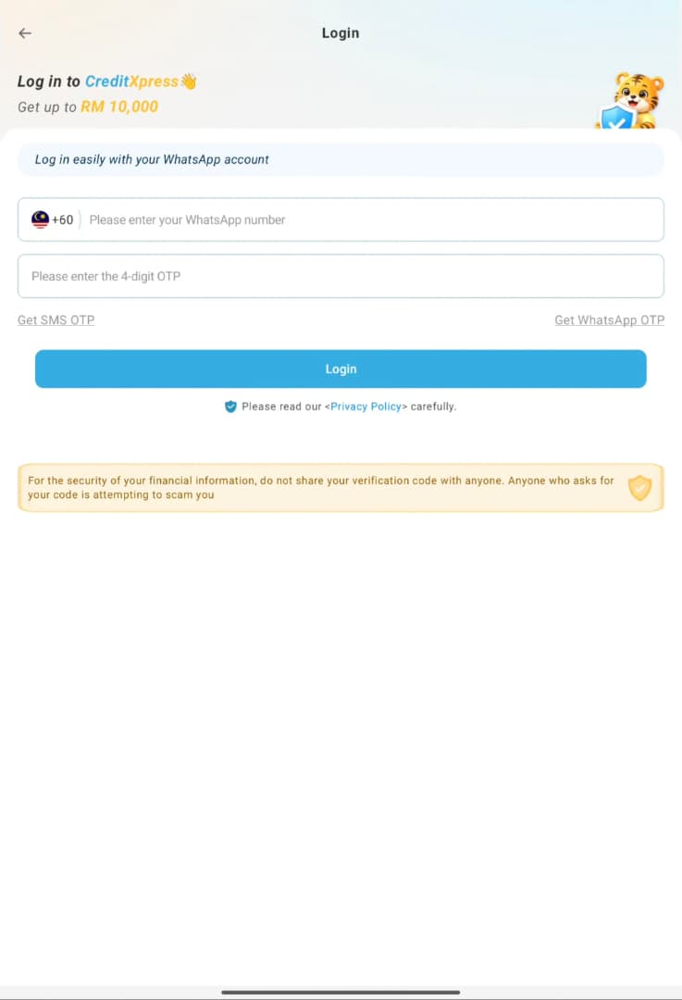
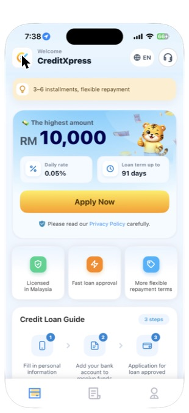
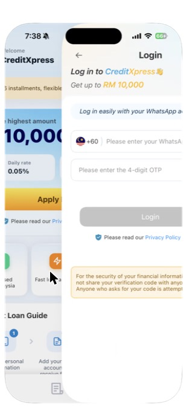
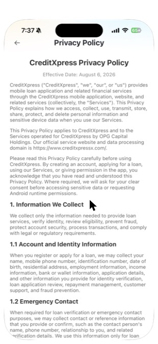
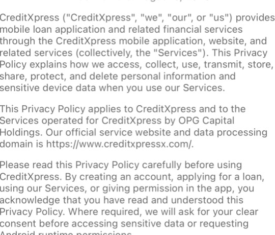
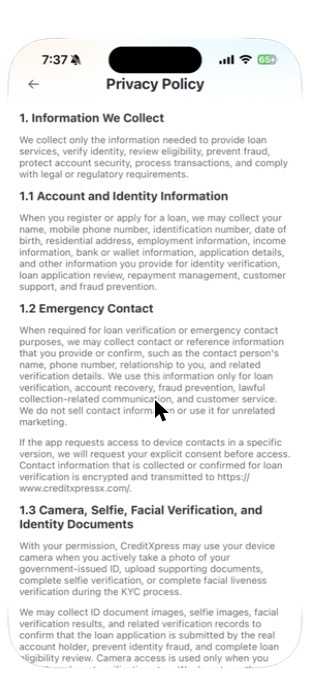

# Credit Xpress: An Ethical Review of a Malaysian Loan App

> **COMP3041 Professional Ethics in Computing: Part 1 Proposal, Group Z**

---

## 1. Introduction and System Selection

This proposal reviews **Credit Xpress**, a Malaysian moneylender licensed mobile app that offers small personal loans through an Android app, an iOS app and a website. We chose this app because it is a local service that Malaysians might turn to when short of cash. Unlike global platforms, it receives almost no outside attention.

The app meets the three conditions mentioned in the coursework rubric:

- **It is real and can be used hands-on**. The app is free to install from Google Play and the App Store.
- **It is small and local.** It operates only in Malaysia, and we found no academic studies of the app itself. Published research covers only the wider category of digital loan apps like Akanji, Egele and Stringhini (Pervez et al., 2026). So, a first-hand review of a licensed local lender adds evidence that the published literature lacks.
- **It has clear ethically relevant features.** It collects personal and device data like location, identity details which the privacy policy says are used "for risk assessment and scoring" (Credit Xpress, 2026a). It handles loans, and its users are likely to be vulnerable people who need cash quickly and for them, a design that pressures them to share data can shape a decision about their money.

---

## 2. Method

Our preliminary investigation combined the following three techniques:

1. **Hands-on walkthroughs.** We installed the app fresh on an Android test device with an empty contact list and recorded every screen from first launch (Xiaomi Pad 7, Android 16, app version 2.1.2, 26/10/2026). We then repeated the flow, denying each permission request, to see how the app handles refusal. A second walkthrough on iOS (iPhone 15 Pro, iOS 26.6.2, app version 1.7.6, 29/10/2026) recorded everything a person can learn from the home screen before signing in.

2. **Document analysis.** We read the in-app privacy policy and the terms and conditions on the company website (Credit Xpress, 2026b), and visited the domain the policy names as its data-processing domain.

3. **Comparison with platform standards.** We compared what we observed with Android's permission guidance (Android Developers, 2026), Google Play's Financial Services policy (Google, 2026) and Apple's App Review Guidelines for personal-loan apps (Apple, 2026).

We used only our own details, did not use a phone number and did not apply for a loan. We used no surveys or interviews, as these require ethics approval. Our findings reflect two devices and one app version per platform, and cover only the part of the app that can be used before sign-in.

---

## 3. Findings

### Walkthrough

**Android.** The first screen is a disclosure statement (Figure 1). Agreeing to it triggers a request for approximate location (Figure 2), then a request to send notifications (Figure 3), before any account or sign-in screen appears. Tapping any button then opens the login page (Figure 4). If the user backs out of the login page, both requests appear again.

**iOS.** The app opens straight to a browsable home screen showing "The highest amount RM 10,000", "Daily rate 0.05%", "Loan term up to 91 days" and an "Apply Now" button (Figure 5). Tapping "Licensed in Malaysia", "More flexible repayment terms" or the support icon opens the login page (Figure 6). The login page asks for a WhatsApp number and a one-time password (OTP). The iOS screen sends the OTP by WhatsApp only, while Android also offers an SMS OTP. Neither offers email, password or guest access.

The privacy policy treats "using our Services" as acknowledgement, refers to "Android runtime permissions" inside the iOS app (Figures 7–8), and names a "data processing domain" (creditxpressx.com) that returned "404 Not Found" on 29/10/2026. The website's terms give two different office addresses, and advertise "RM500–RM20,000" against the app's RM 10,000.

We identified four issues, each with a fair reading: the most charitable legitimate explanation.

### Issue A: Location is requested before the user has an account

An engineer placed the location request on the very first screen, before sign-up or any loan terms, so a person who has not chosen to apply is already being asked for scoring data. Android's guidance says to ask "in context, when the user starts to interact with the feature that requires it" (Android Developers, 2026). The disclosure statement gives five purposes for location (Figure 1), but only one, service-region eligibility, could apply before sign-up. The other four need an account or a loan application, and the user has neither.

> **Fair reading:** a Malaysia-only lender may need approximate location to screen out overseas applicants, and Google bans only *precise* location for loan apps (Google, 2026). The concern is not what is requested, but when.

### Issue B: The app asks again when the user leaves the login page

The second round of requests is tied to leaving the login page, an action unrelated to location or notifications, and is shown to a user who has just shown *less* interest in the service. On Android 11 and later, a second denial counts as a permanent "don't ask again" (Android Developers, 2026). The app therefore uses every request the operating system allows before the user has signed up or seen any terms, when the same guidance tells developers to "gracefully degrade your app so that the user can continue" after a refusal.

> **Fair reading:** notifications carry little privacy risk, and the requests themselves may be legitimate. What we question is how a refusal is handled.

### Issue C: The cost of borrowing is shown as a small daily rate, not an annual rate

The only price shown before sign-up is "Daily rate 0.05%" (Figure 5). Neither the app nor the website gives an annual percentage rate (APR), fees, stamp duty or a sample total repayment. The terms say interest is "as stated in the Moneylending Agreement", which is signed after approval, and that "once you have submitted a loan application, cancellation of the application is not allowed" (Credit Xpress, 2026b). The full cost therefore appears only when the borrower can no longer back out.

0.05% sounds negligible, but over a year it comes to about 18.25% simple interest. Malaysia caps unsecured moneylender loans at 18% a year (The Vibes, 2025), so the true annual figure sits at or near the legal limit, and the daily figure hides this. Apple requires personal-loan apps to "clearly and conspicuously disclose all loan terms, including … equivalent maximum Annual Percentage Rate (APR)" (Apple, 2026, 3.2.2(ix)), and this screen does not.

> **Fair reading:** the daily rate is accurate, short loans are sometimes priced daily, and fees may appear in the agreement. We question why the figure least likely to alarm a borrower is the only one shown.

### Issue D: Users cannot check who the lender is or contact it without signing in

The home screen says "Licensed in Malaysia", but tapping it opens the login page rather than a licence number (Figure 6). The support icon does the same, so a person with a question or complaint must first hand over a phone number. The documents that should fill this gap are unreliable: the data-processing domain is dead, the iOS policy refers to Android, and the terms give two addresses. The policy also allows the app to collect "emergency contact" names and phone numbers (Figure 9). These people are never asked for consent.

> **Fair reading:** the licence number and addresses are on the website, so the information exists. The engineering choice is to put it behind sign-in inside the app, where most users will look.

---

## 4. Literature Review

**Early data collection.** Akanji, Egele and Stringhini (2026) measured 435 Android loan apps in five countries outside Malaysia. They found that 73.4% of approved apps broke Google's or national permission rules, and 37 of the 148 that launched sent sensitive data immediately, before any registration. Pervez et al. (2026) found that 85% of participants with limited literacy did not understand basic app permissions. Both support Issue A. The literature describes apps that block users who refuse; it does not describe the softer pattern in Issue B, where a refusal is met with repeated prompts.

**Hiding the cost.** Mathur et al. (2019) found dark patterns on about 11% of 11,000 shopping websites, including designs that withhold information until late. We found no study that tests daily-rate framing in loan apps. The closest evidence is Morwitz, Greenleaf and Johnson (1998): when a price is split into smaller parts, consumers recall a lower total. A daily rate plausibly works the same way, which is why both app stores require loan apps to disclose the APR (Apple, 2026; Google, 2026). This supports Issue C.

**Harm beyond the borrower.** Akanji, Egele and Stringhini (2026) link contact data in loan apps to debt-collection shaming of people who never installed the app, a harm they call "entirely non-consensual". Consent research explains why "consent by use" protects little: individuals cannot realistically assess how their data will be used (Solove, 2013), and most skip privacy policies entirely (Obar and Oeldorf-Hirsch, 2020). This supports Issue D.

**The gap.** Existing studies are large-scale, automated and focused on unlicensed apps outside Malaysia. None examines a licensed Malaysian lender, iOS, or how an app's design times its requests and its disclosure of cost. Our walkthrough addresses this.

---

## 5. Ethical Framework

We analysed each issue against the ACM/IEEE Software Engineering Code of Ethics (ACM/IEEE-CS, 1999), then tested it against ethical theory, and identified where the Code alone does not settle the question.

| Issue | Main clauses violated | Strongest theory |
|---|---|---|
| A: Location before sign-up | 1.06 (avoid deception), 3.06 (follow professional standards), 3.12 (respect privacy), 3.13 (properly authorised data) | Deontology |
| B: Re-prompt on leaving login | 1.06, 3.06, 3.12, 3.13 | Deontology, care ethics |
| C: Daily rate, not APR | 1.03 (public good), 1.06, 3.10 (adequate review), 3.12, 3.13 | Deontology, utilitarianism, care ethics |
| D: Lender hidden behind sign-in | 1.06, 3.08 (documented specifications), 3.12, 3.13, 6.07 (accurate claims) | Deontology, utilitarianism |

**Issue A.** Listing five purposes when four do not yet apply makes the request look more necessary than it is (1.06). Asking before any feature needs location departs from Android's guidance (3.06), and data gathered before the user has seen any terms is not properly authorised (3.13). Deontologically, this breaks the duty of truthfulness and treats the user merely as a source of scoring data. Clause 2.09 (serve the employer's interests) gives way when "a higher ethical concern is being compromised", but the Code does not say whether early location collection is serious enough to count. Deontology answers that: misleading justifications and bypassed consent are wrong however small the harm.

**Issue B.** A refusal is a rational choice. Re-asking on an unrelated trigger treats it as an obstacle to work around, and so fails Kant's requirement to treat people as ends. If every app re-prompted until the system limit, refusal would mean nothing. The Code is silent on the timing and number of permission requests, and the decision may lie with product teams. Care ethics fills the gap: a user with no account, no terms and no context depends on the company, and a responsible professional would not spend that user's last refusal on an unrelated trigger.

**Issue C.** Showing only the least alarming figure, and the full cost only after cancellation is barred, is deceptive in effect even though no number is false (1.06). Failing Apple's disclosure standard suggests inadequate review (3.10). Deontologically, the borrower's lack of information is used as a means to secure the loan. In utilitarian terms, the company's gain in conversions is outweighed by borrowers' exposure to unaffordable, uncancellable debt. Care ethics adds that the borrower's urgent need creates a dependence a responsible lender should not exploit.

**Issue D.** A licence claim that cannot be checked where it is made is "doubtful" under 6.07. Documents pointing to a dead domain, with conflicting addresses, fail 1.06 and 3.08. Emergency contacts are "affected by" the software under 3.12, yet they never authorise the use of their data (3.13). The Code does not address whether one person's consent can stand in for another's. A Kantian view settles it: third parties have their own right to consent, which the borrower cannot waive for them. Utilitarian reasoning helps an engineer judge when harm to such third parties justifies escalating concerns beyond the employer.

---

## 6. Plan for Part 2

1. With module approval, sign up with a dedicated phone number and record the full application flow (contacts, camera, emergency contacts) and the APR disclosed in the Moneylending Agreement, to test whether the real cost exceeds the 18% cap (Issue C).

2. Systematically code Google Play and App Store reviews for complaints about collection harassment and hidden fees (Issues C and D).

3. Reinstall the app on iOS to test whether the permission timing in Issues A and B also occurs there.

---

## References

ACM/IEEE-CS Joint Task Force on Software Engineering Ethics and Professional Practices (1999) *Software Engineering Code of Ethics and Professional Practice*, version 5.2. Available at: https://ethics.acm.org/code-of-ethics/software-engineering-code/ (Accessed: 3 November 2026).

Akanji, O.A., Egele, M. and Stringhini, G. (2026) ‘The cost of convenience: identifying, analyzing, and mitigating predatory loan applications on Android’, *Proceedings of the ACM Asia Conference on Computer and Communications Security (ASIA CCS ’26)*, pp. 1445–1460. doi:10.1145/3779208.3785263.

Android Developers (2026) *Request runtime permissions*. Available at: https://developer.android.com/training/permissions/requesting (Accessed: 26 October 2026).

Apple (2026) *App Review Guidelines*, section 3.2.2(ix). Available at: https://developer.apple.com/app-store/review/guidelines/ (Accessed: 29 October 2026).

Credit Xpress (2026a) *Privacy policy*. Available at: https://creditxpress.com.my/ (Accessed: 26 October 2026).

Credit Xpress (2026b) *Terms and conditions*. Available at: https://creditxpress.com.my/ (Accessed: 29 October 2026).

Google (2026) *Financial services*. Play Console Help. Available at: https://support.google.com/googleplay/android-developer/answer/9876821 (Accessed: 26 October 2026).

Mathur, A., Acar, G., Friedman, M.J., Lucherini, E., Mayer, J., Chetty, M. and Narayanan, A. (2019) ‘Dark patterns at scale: findings from a crawl of 11K shopping websites’, *Proceedings of the ACM on Human-Computer Interaction*, 3(CSCW), pp. 1–32. doi:10.1145/3359183.

Morwitz, V.G., Greenleaf, E.A. and Johnson, E.J. (1998) ‘Divide and prosper: consumers’ reactions to partitioned prices’, *Journal of Marketing Research*, 35(4), pp. 453–463.

Obar, J.A. and Oeldorf-Hirsch, A. (2020) ‘The biggest lie on the Internet: ignoring the privacy policies and terms of service policies of social networking services’, *Information, Communication & Society*, 23(1), pp. 128–147.

Pervez, M.M., Ullah, M.Q.A., Khan, I.A., Rahat, R., Sheikh, A.F., Zaffar, M.F., Tahir, R., Rahwan, T. and Zaki, Y. (2026) ‘(Mis-)informed consent: predatory apps and the exploitation of populations with limited literacy’, *arXiv preprint* arXiv:2601.17025. Available at: https://arxiv.org/abs/2601.17025 (Accessed: 26 October 2026).

Solove, D.J. (2013) ‘Privacy self-management and the consent dilemma’, *Harvard Law Review*, 126(7), pp. 1880–1903.

The Vibes (2025) *Licensed moneylenders charging excessive interest face fines and jail, warns ministry*. Available at: https://www.thevibes.com/articles/news/115088/ (Accessed: 29 October 2026).

---

## Appendix: Figures

<table>
<tr>
<td align="center" valign="top" width="33%"> <b>Figure 1:</b> disclosure statement on first launch (Android)</td>
<td align="center" valign="top" width="33%"> <b>Figure 2:</b> location permission prompt before sign-up (Android)</td>
<td align="center" valign="top" width="33%"> <b>Figure 3:</b> notification permission prompt before sign-up (Android)</td>
</tr>
<tr>
<td align="center" valign="top" width="33%"> <b>Figure 4:</b> login page (Android)</td>
<td align="center" valign="top" width="33%"> <b>Figure 5:</b> home screen before sign-in (iOS)</td>
<td align="center" valign="top" width="33%"> <b>Figure 6:</b> tapping "Licensed in Malaysia" opens the login page (iOS)</td>
</tr>
<tr>
<td align="center" valign="top" width="33%"> <b>Figure 7:</b> in-app privacy policy (iOS)</td>
<td align="center" valign="top" width="33%"> <b>Figure 8:</b> consent-by-use and "Android runtime permissions" wording</td>
<td align="center" valign="top" width="33%"> <b>Figure 9:</b> emergency contact section of the privacy policy</td>
</tr>
</table>
