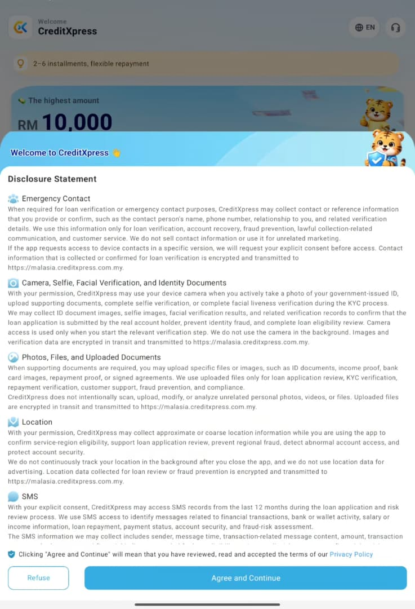
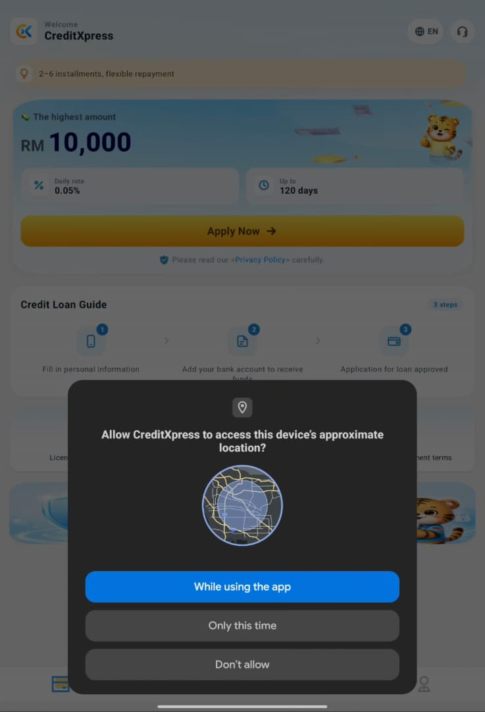
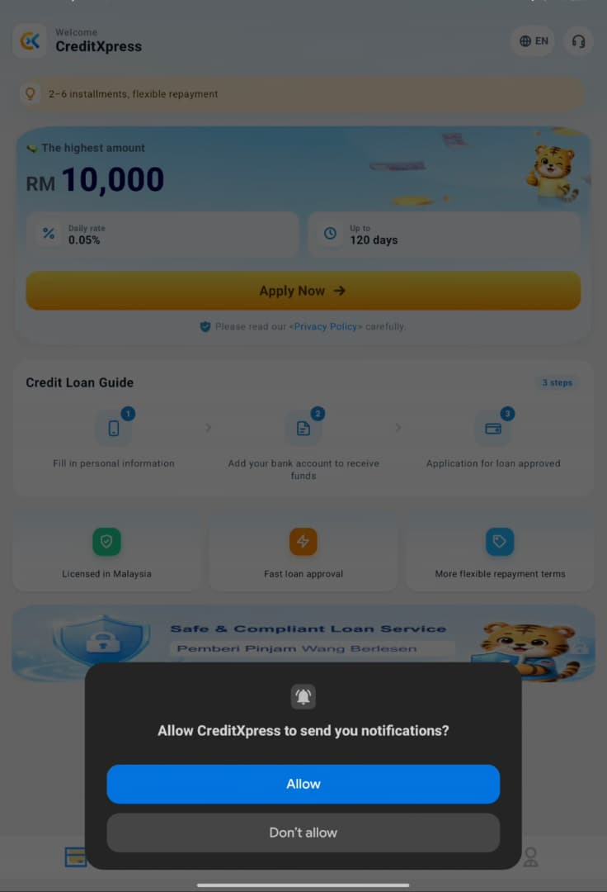
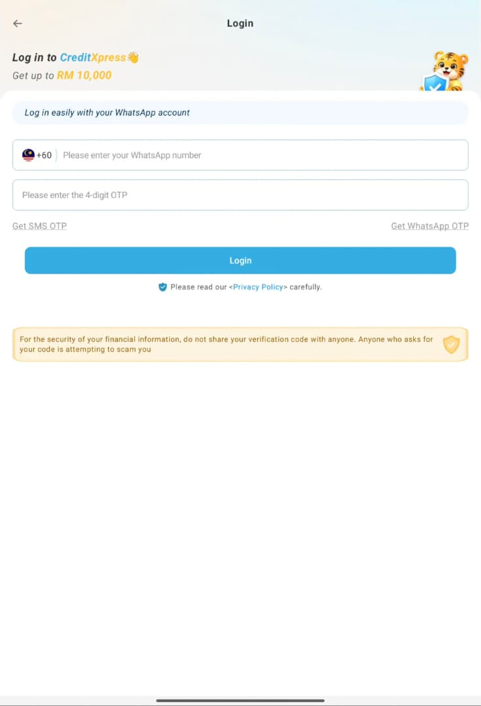

# Findings

## Walkthrough

The first screen is a disclosure statement. Agreeing to it triggers two system permission requests before any account or sign-up screen appears:

1. The disclosure statement appears on first launch. [Figure 1: disclosure statement screen]
2. A request for approximate location appears. [Figure 2: first location permission prompt]
3. A request for notifications appears. [Figure 3: first notification permission prompt]
4. Clicking on any button brings us to the login page [Figure 4: login page]
5. Exiting the login makes both notifications appear again [Figure 2 & 3]
6. …

## Issue A: Location is requested before the user has an account

An engineer placed the location request on the very first screen, before sign-up, before any loan terms are shown, and before the user has any reason to share where they are. The privacy policy says location is collected "for risk assessment and scoring", so a person who has not yet chosen to apply is already being asked for scoring data. Android's developer guidance says to ask "in context, when the user starts to interact with the feature that requires it" (Android Developers, 2026). At this point there is no feature to interact with. The disclosure statement gives five purposes: to "confirm service-region eligibility, support loan application review, prevent regional fraud, detect abnormal account access, and protect account security" [Figure 1]. Only the first could apply before sign-up. The other four need a loan application or an account, and at this point the user has neither.

## Issue B: The app asks again when the user leaves the login page

After the first two requests, any button opens its login page. If the user backs out of it without signing in, both requests appear again. An engineer tied this second request to leaving the login page, an action unrelated to location or notifications. A user who backs out has, if anything, shown less interest in the service, yet is asked again. On Android 11 and later, a second denial counts as permanent "don't ask again" (Android Developers, 2026). The app therefore uses every request the operating system allows before the user has signed up or seen any loan terms. The same guidance tells developers to "gracefully degrade your app so that the user can continue" after a denial, rather than repeat the request.

A fair reading must allow for legitimate purposes. A Malaysia-only lender may use approximate location to screen out overseas applicants, and approximate location is not among the permissions Google bans for loan apps (only precise location is) (Google, 2026). Notifications carry little privacy risk. The concern is therefore not what is requested but when, and how a refusal is handled.

## Figures

**Figure 1: disclosure statement screen**

**Figure 2: location permission prompt**

**Figure 3: notification permission prompt**

**Figure 4: login page**

