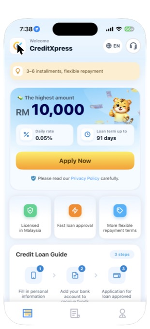
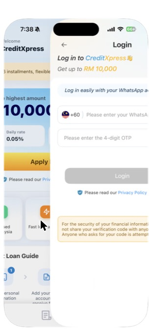
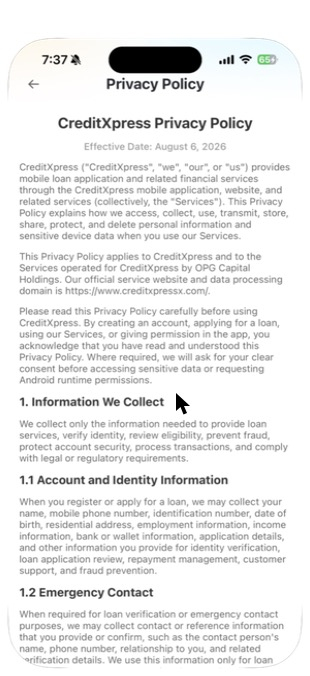
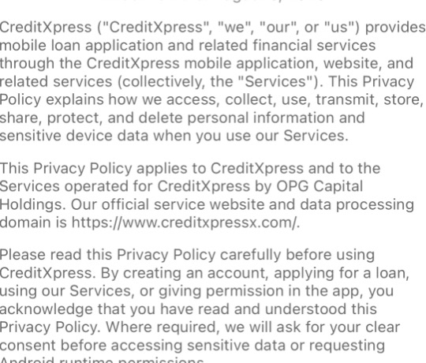
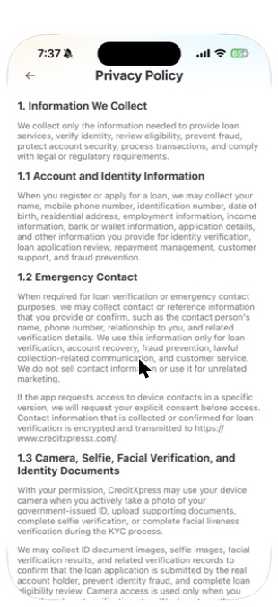

# Findings

## Walkthrough (Android)

The first screen is a disclosure statement. Agreeing to it triggers two system permission requests before any account or sign-up screen appears:

1. The disclosure statement appears on first launch. [Figure 1: disclosure statement screen]
2. A request for approximate location appears. [Figure 2: first location permission prompt]
3. A request for notifications appears. [Figure 3: first notification permission prompt]
4. Clicking on any button brings us to the login page [Figure 4: login page]
5. Exiting the login makes both notifications appear again [Figure 2 & 3]

## Walkthrough (iOS, before sign-in)

On iOS the app opened straight to a browsable home screen, so Issues A and B below were observed on Android only. iOS shows each location or notification prompt only once per install, and the test iPhone had opened the app before, so we could not repeat that test without reinstalling (see the Part 2 plan).

1. The home screen shows "The highest amount RM 10,000", "Daily rate 0.05%", "Loan term up to 91 days" and "3–6 installments, flexible repayment", with an "Apply Now" button. [Figure 5]
2. Tapping "Licensed in Malaysia", "More flexible repayment terms" or the customer-support (headset) icon opens the same WhatsApp login page. [Figure 6, Figure 4]
3. The login page asks for a WhatsApp number and a one-time password (OTP). The iOS screen we recorded sends the OTP by WhatsApp only [Figure 6]; the Android login page also offers an SMS OTP [Figure 4]. No email, password or guest option is offered on either.
4. The in-app privacy policy states that use of the app counts as acknowledgement of the policy, and refers to "Android runtime permissions" even though it is shown in the iOS app. [Figures 7–8]
5. The policy names https://www.creditxpressx.com/ as the "official service website and data processing domain". On 29/10/2026 this address returned "404 Not Found".
6. The website's terms give two different office addresses for the same company (Bayan Lepas, Penang in section 1, Kuala Lumpur in the "Issuing Entity" box). The page title advertises "RM500–RM20,000", while the app advertises up to RM 10,000 (Credit Xpress, 2026b).

## Issue A: Location is requested before the user has an account

An engineer placed the location request on the very first screen, before sign-up, before any loan terms are shown, and before the user has any reason to share where they are. The privacy policy says location is collected "for risk assessment and scoring", so a person who has not yet chosen to apply is already being asked for scoring data. Android's developer guidance says to ask "in context, when the user starts to interact with the feature that requires it" (Android Developers, 2026). At this point there is no feature to interact with. The disclosure statement gives five purposes: to "confirm service-region eligibility, support loan application review, prevent regional fraud, detect abnormal account access, and protect account security" [Figure 1]. Only the first could apply before sign-up. The other four need a loan application or an account, and at this point the user has neither.

## Issue B: The app asks again when the user leaves the login page

After the first two requests, any button opens its login page. If the user backs out of it without signing in, both requests appear again. An engineer tied this second request to leaving the login page, an action unrelated to location or notifications. A user who backs out has, if anything, shown less interest in the service, yet is asked again. On Android 11 and later, a second denial counts as permanent "don't ask again" (Android Developers, 2026). The app therefore uses every request the operating system allows before the user has signed up or seen any loan terms. The same guidance tells developers to "gracefully degrade your app so that the user can continue" after a denial, rather than repeat the request.

A fair reading must allow for legitimate purposes. A Malaysia-only lender may use approximate location to screen out overseas applicants, and approximate location is not among the permissions Google bans for loan apps (only precise location is) (Google, 2026). Notifications carry little privacy risk. The concern is therefore not what is requested but when, and how a refusal is handled.

## Issue C: The cost of borrowing is shown as a small daily rate, not an annual rate

The only price shown before sign-up is "Daily rate 0.05%" [Figure 5]. Neither the app nor the website gives an annual percentage rate (APR), fees, stamp duty or a sample total repayment. The website's terms say only that interest is "as stated in the Moneylending Agreement", and the agreement is signed after approval. The same terms state that "once you have submitted a loan application, cancellation of the application is not allowed" (Credit Xpress, 2026b). The full cost therefore appears only once the borrower can no longer back out.

Stating a rate per day is a design choice. 0.05% sounds negligible, but simple interest over a year comes to about 18.25%. Malaysia caps unsecured moneylender loans at 18% a year (KPKT, reported in The Vibes, 2025), so the true annual figure sits at or near the legal limit, which the daily figure hides. Apple's App Review Guidelines require personal-loan apps to "clearly and conspicuously disclose all loan terms, including … equivalent maximum Annual Percentage Rate (APR) and payment due date" (Apple, 2026, 3.2.2(ix)). This screen does not meet that requirement. The headline amount also differs between channels (RM 10,000 in the app, RM 20,000 on the website). A borrower who compares the two cannot tell which offer is real.

A fair reading: a daily rate is accurate, and short loans (up to 91 days) are sometimes priced daily. Fees may appear in the agreement. What we question is that the figure least likely to alarm a borrower is the only one shown, and that the full figure arrives only after cancellation is barred. We have not seen the agreement, so whether the real cost exceeds the cap is left for Part 2.

## Issue D: Users cannot check who the lender is or contact it without signing in

Before sign-in, the home screen invites trust ("Licensed in Malaysia") but does not let the user check it. Tapping the licence tile opens the WhatsApp login page rather than a licence number [Figure 6]. The support icon does the same, so a person with a question or complaint must first hand over a phone number. The number field asks for a WhatsApp number, and the iOS screen offers only a WhatsApp OTP [Figure 6]. Android also offers an SMS OTP [Figure 4], but on either platform a user cannot ask a question without first giving a phone number.

The documents that should fill this gap are not reliable. The privacy policy counts simply "using our Services" as acknowledgement of the policy [Figure 8], yet the "data processing domain" it names returned a 404 error when we visited. It also refers to Android permissions inside the iOS app, which suggests it was not written for the platform where it appears. The company's own terms list two different office addresses. The policy also lets the app collect "emergency contact" names and phone numbers [Figure 9]. These people are never asked for consent, and the literature links such data to debt-collection harassment in predatory loan apps (Akanji, Egele and Stringhini, 2026).

The licence number, both addresses and a contact email can be found on the website, so the information exists. The engineering choice is to put it behind sign-in inside the app, where most users will look, and to treat use of the app as consent to a policy that points to a dead address.

## Figures

**Figure 1: disclosure statement screen**

**Figure 2: location permission prompt**

**Figure 3: notification permission prompt**

**Figure 4: login page**

**Figure 5: iOS home screen before sign-in**

**Figure 6: tapping "Licensed in Malaysia" opens the login page**

**Figure 7: in-app privacy policy (iOS)**

**Figure 8: consent-by-use and "Android runtime permissions" wording**

**Figure 9: emergency contact section of the privacy policy**

